# RackPlanner


A self-hosted visual designer for home-lab server racks. Pick a 19″ or 10″ rack (1–32U), drag hardware from a researched catalog of ~340 parts into it, put desktop gear on shelves, and check the totals: power vs UPS capacity, PoE budget, mains outlets, weight and ports. Export the result as PNG, SVG, PDF, CSV or JSON.

Runs as a single Docker container with a SQLite database. No accounts and no cloud; it's built for your LAN.

## Features

- **Detailed faceplates, front and rear:** every device is drawn as SVG from catalog data: RJ45 jacks with link/activity LEDs and latch notches, metallic SFP/QSFP cages, USB, HDMI, IEC and AU/NZ power, keystones, drive trays, displays, vents, fans and PSUs. Popular gear has a researched, sourced layout; everything else gets a sensible generated one. No logos or product photos.
- **Style presets:** UniFi-style silver/white/black, server bezel, NAS grey, PDU, UPS, patch and brush panels and more, all fine in light and dark mode. Lit LEDs, or switch them off for a clean print look.
- **Rack frames:** 2-post, 4-post, enclosed cabinet (with glass door) and 10″ mini racks including the **DeskPi RackMate T1 / T2**, with rails, cage-nut holes at EIA spacing and free-slot hints.
- **Shelf plans:** a top-down view of every shelf showing how devices fit side by side, with overhangs flagged.
- **Placement:** drag and drop with U snapping, collision checks, front / rear / full-depth mounting, partial-width gear and desktop gear on shelves. Warns when something is too wide, deep or tall for its shelf.
- **Power sources:** USB-C, DC adapters, plug-packs and IEC inlets per device, checked against the outlets your power boards provide.
- **Cables:** colour-coded port-to-port patch cables, with tooltips on every port ("Port 17 — 1 GbE (PoE+)").
- **Zoom-aware detail:** simplified blocks when zoomed out and full detail up close, so a full 32U rack stays smooth.
- **Catalog:** full UniFi lineup plus MikroTik, Synology, QNAP, UGREEN, TP-Link, Netgear, Cisco, Dell, HPE, Supermicro, APC, CyberPower, Eaton, DeskPi, Raspberry Pi and generic passive gear, with search, filters and a **custom part builder**.
- **Designs, stats and exports:** autosave, undo / redo, power / UPS / PoE / weight totals with warnings, and PNG / SVG / PDF / CSV / JSON exports.

## Gallery

| | |
|---|---|
| 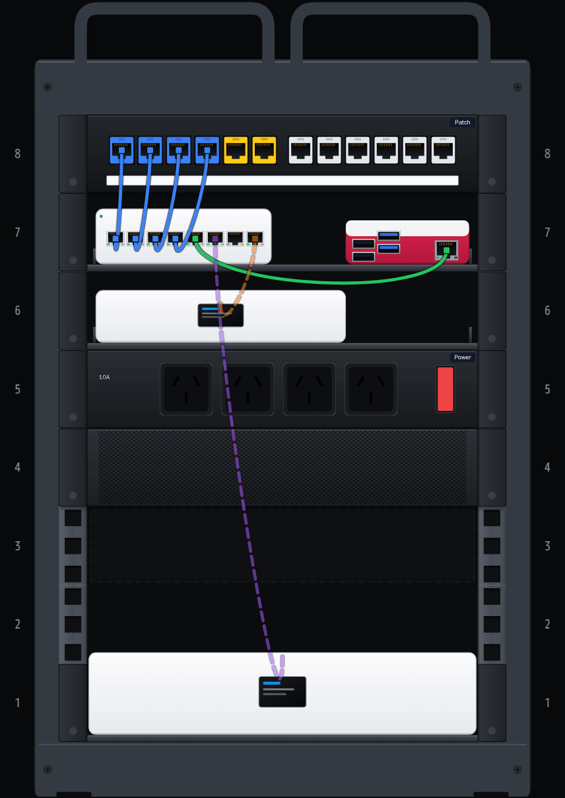 | 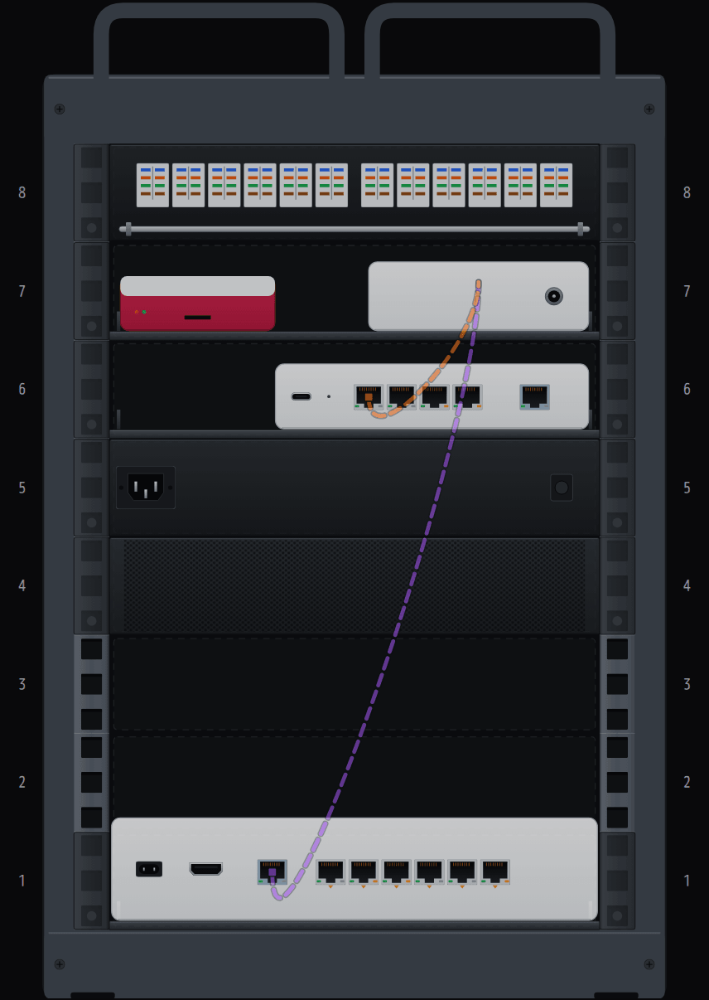 |
| **My RackMate T1, front:** a 10″ 8U DeskPi RackMate T1 with desktop UniFi gear on shelves. | **And the rear:** each device's rear panel, seen through the open back. |
| 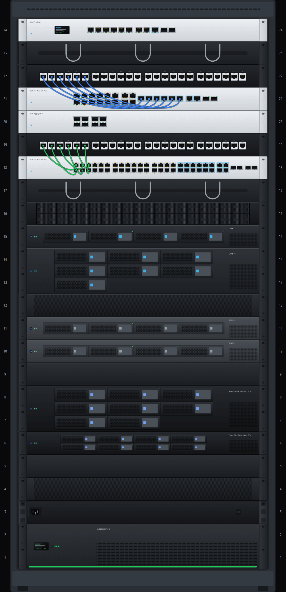 | 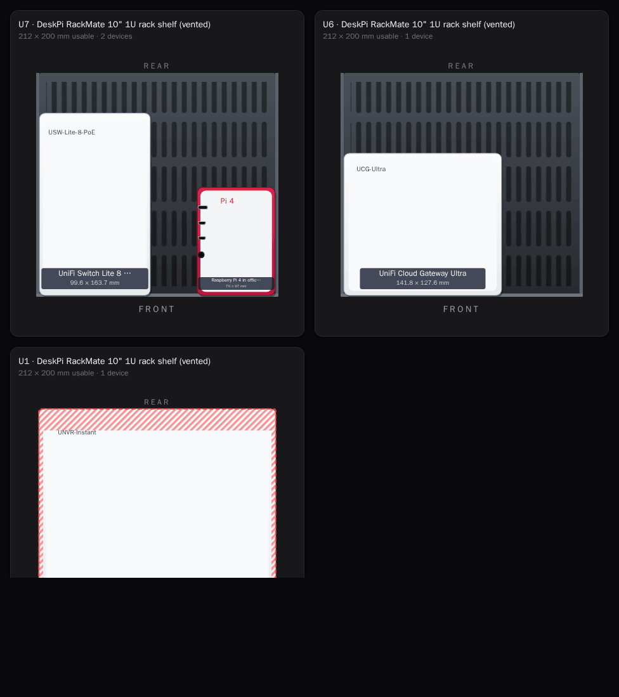 |
| **A full 24U 19″ cabinet:** UniFi, servers, NAS, patch panels, PDU and UPS. | **Shelf plans:** how desktop gear fits on each shelf, with overhangs hatched red. |
| 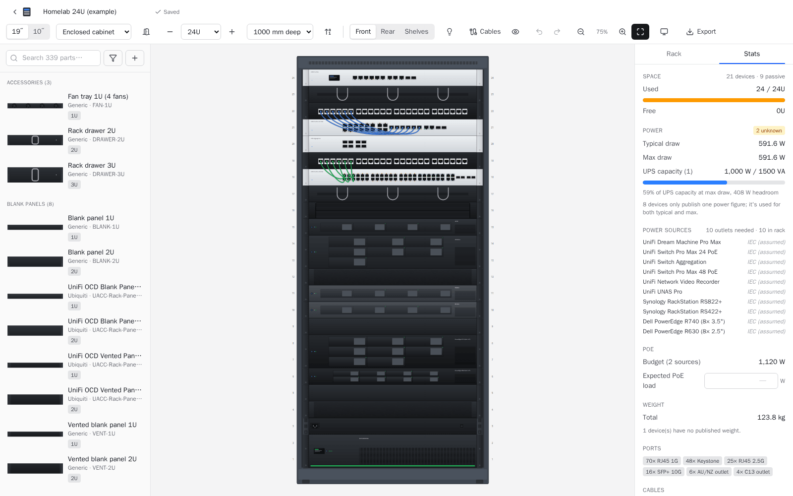 | 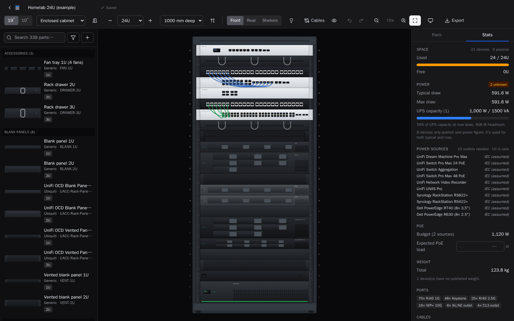 |
| **Light mode** | **Dark mode** |
| 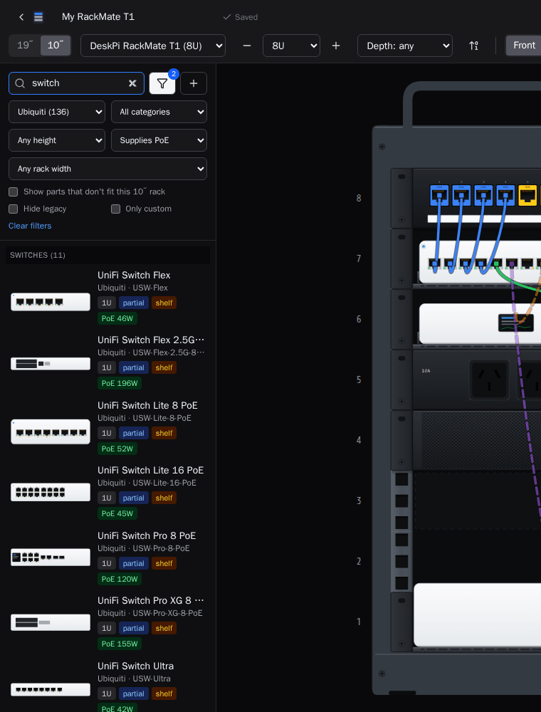 | 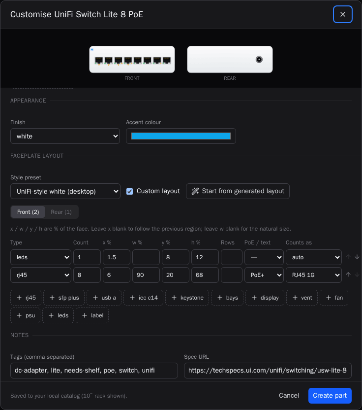 |
| **Catalog** with search and filters. | **Custom part builder** with a live preview. |
| 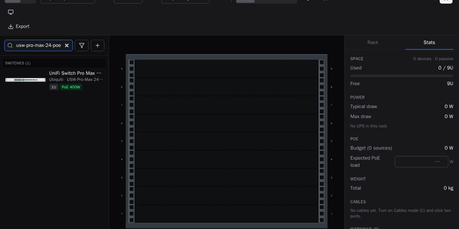 | |
| **Drag and drop** from the catalog, then rearrange. | |

## Device renders

Front faceplates exported as SVG, straight from the renderer.

| | |
|---|---|
| 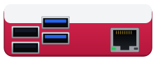 |  |
| Raspberry Pi 4 (official case) | UniFi Cloud Gateway Ultra |
| 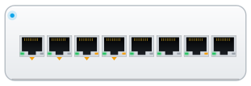 |  |
| UniFi Switch Lite 8 PoE | UniFi NVR Instant |
| 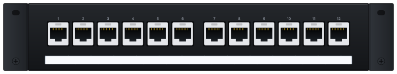 | 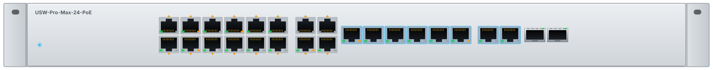 |
| DeskPi 10″ 12-port keystone panel | Preset: UniFi silver |
| 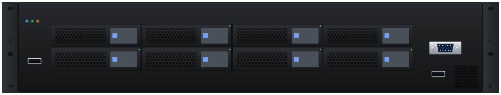 | 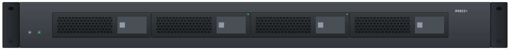 |
| Preset: server bezel | Preset: NAS grey |
| 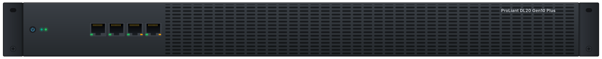 | 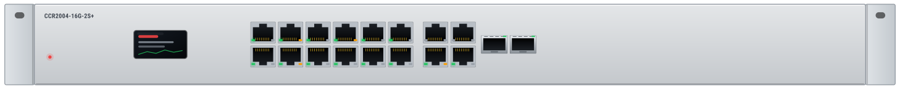 |
| Preset: dark server | Preset: light metal |
| 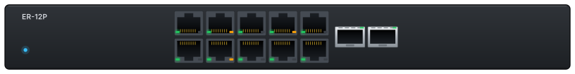 | 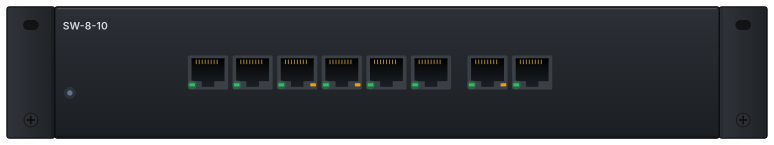 |
| Preset: UniFi black | Preset: generic black |
| 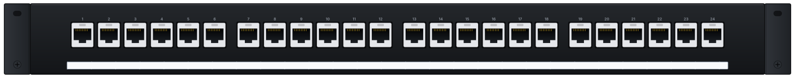 | 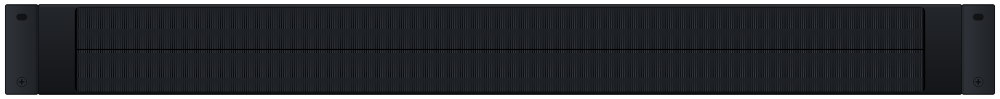 |
| Preset: patch panel | Preset: brush panel |
| 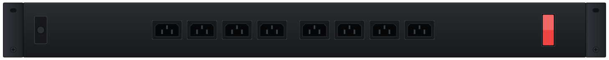 | 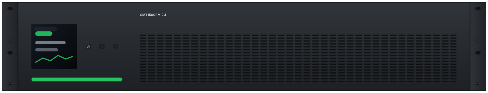 |
| Preset: PDU | Preset: UPS |
| 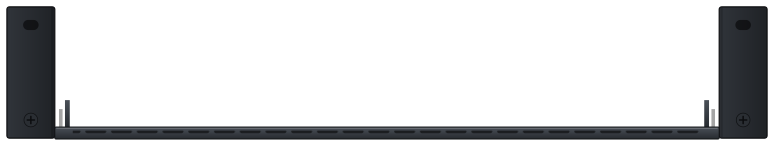 | 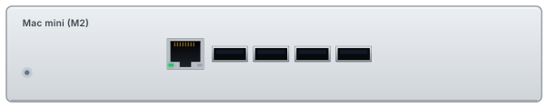 |
| Preset: shelf | Preset: generic silver |

All images are generated by `npm run screenshots` (see [Development](#development)); none are hand-edited, and none are manufacturer photos or logos.

## Install on Ubuntu

1. **Install Docker** (skip if you already have it):

   ```bash
   curl -fsSL https://get.docker.com | sudo sh
   sudo usermod -aG docker $USER   # log out and back in afterwards
   ```

2. **Get RackPlanner and start it:**

   ```bash
   git clone https://github.com/fipity/rackplanner.git
   cd rackplanner
   cp .env.example .env            # optional: port, PUID/PGID, basic auth
   docker compose up -d
   ```

3. Open **`http://<server-ip>:8085`**.

The first build takes a few minutes. The container restarts automatically (`restart: unless-stopped`), and `docker compose ps` shows its health (`GET /api/health`).

### Configuration (`.env`)

| Variable | Default | |
|---|---|---|
| `RACKPLANNER_PORT` | `8085` | Host port. Change it, then run `docker compose up -d` |
| `PUID` / `PGID` | `1000` | Owner of `./data` on the host (run `id` to see yours) |
| `BASIC_AUTH_USER` / `BASIC_AUTH_PASS` | empty | Set both to require a password. `/api/health` stays open |
| `LOG_LEVEL` | `info` | `debug`, `warn`, `error`, `silent`… |

### Updating

```bash
cd rackplanner
git pull && docker compose up -d --build
```

Designs and custom parts live in `./data` and survive rebuilds. Catalog changes are applied on startup, and existing designs keep working: parts removed from the catalog are retired, not deleted.

### Backup and restore

Everything (designs, custom parts, catalog state) is in one SQLite database: `./data/rackplanner.db`.

- **From the app:** use the **Backup** button on the home screen, or run `curl -o rackplanner-backup.db http://<server-ip>:8085/api/backup`. This is a consistent snapshot, taken safely while the app runs. Single designs can also be exported as JSON and re-imported.
- **Manually:** `docker compose stop && tar czf rackplanner-data-$(date +%F).tgz data && docker compose start`
- **Restore:** stop the container, replace the database, and remove the leftover write-ahead files so SQLite doesn't replay them onto the restored copy:

  ```bash
  docker compose stop
  cp rackplanner-backup.db data/rackplanner.db     # or: tar xzf rackplanner-data-<date>.tgz
  rm -f data/rackplanner.db-wal data/rackplanner.db-shm
  docker compose start
  ```

### Raspberry Pi / ARM

The image supports **amd64 and arm64**. On a Pi 4/5 or other arm64 host, `docker compose up -d --build` builds natively. To build both architectures elsewhere, e.g. for a registry:

```bash
docker buildx build --platform linux/amd64,linux/arm64 -t <registry>/rackplanner:latest --push .
```

## Using the editor

| Action | How |
|---|---|
| Add a part | Drag it from the catalog into the rack, or click it to drop it in the first free slot |
| Move | Drag a placed part (red = blocked, with the reason shown next to the cursor) |
| Put desktop gear on a shelf | Drag it onto a shelf, or just click it in the catalog: it goes onto a shelf with room. It stands on the tray and snaps beside items already there |
| Select a shelf that has gear on it | Click its ears or tray, or the shelf name in an item's details |
| Draw cables | Press <kbd>C</kbd> (or **Cables** in the toolbar), click a port or device, then the other end. <kbd>Esc</kbd> finishes |
| Edit / delete a cable | Click it to edit type, colour, ports, length, label; <kbd>Del</kbd> removes it |
| Partial-width position | Select a 10″ / half-width part (or a shelf item), choose **Left / Centre / Right** |
| Move by 1U | <kbd>↑</kbd> / <kbd>↓</kbd> (shelves take their contents with them) |
| Delete / duplicate | <kbd>Del</kbd> / <kbd>Ctrl</kbd>+<kbd>D</kbd> |
| Undo / redo | <kbd>Ctrl</kbd>+<kbd>Z</kbd> / <kbd>Ctrl</kbd>+<kbd>Shift</kbd>+<kbd>Z</kbd> |
| Zoom | <kbd>+</kbd> / <kbd>-</kbd>, <kbd>0</kbd> to fit, or <kbd>Ctrl</kbd>+scroll |
| Measured power | Select a device and enter watts in *Measured power* |
| Export / print | **Export** menu in the header |

Changing the rack width, height or depth so that some parts no longer fit asks for confirmation and lists what would be removed. You can undo afterwards.

## Cables

Turn on **Cables** mode (<kbd>C</kbd>) and every drawn port becomes clickable. Click one end, then the other, to add a cable. You can connect two ports, or a port to a whole device when the port isn't drawn (e.g. the NIC on a desktop NAS). The cable type is guessed from the ports (copper, DAC, fibre or power) and can be changed. Select a cable to set its colour, change either end's port, add a label, or set a length. **Use … m** suggests a standard patch-lead length from the distance between the ends, plus slack.

Cables between the front and the rear (or to a device on the other face) are drawn dashed. The eye button hides them all. Deleting a device removes its cables, and undo brings everything back. Warnings flag two cables on one port, ports that don't exist on a device, and cables to deleted devices. The CSV, PDF and printable parts lists include a cable shopping list grouped by type and length.

## Designs

The home screen lists your designs with live thumbnails. Create a new one by picking a width, a height preset and an optional depth. Rename, duplicate or delete designs from each card's menu, and **Import** a design exported as JSON. JSON exports include any custom parts the design uses, so they move cleanly between RackPlanner installs.

Changes save automatically as you work. If the same design is saved from another tab or device, you're asked whether to keep your version or load the latest one.

## Stats & warnings

The **Stats** tab, next to the device details, updates live:

- **Space:** U used and free (a U counts as used if anything occupies it, front or rear), plus device and passive counts.
- **Power:** typical and max draw. A device's **measured power** (e.g. from a smart plug or PDU reading) replaces catalog figures. When a part only publishes one figure, it's used for both. Catalog max power excludes PoE output, so the **expected PoE load** you enter is added on top before comparing against total **UPS capacity**.
- **PoE:** total PoE budget of the switches and gateways in the rack, compared with your expected PoE load.
- **Weight** and **port counts** by type.
- **Cables:** count by type and total length.
- **Warnings:** devices deeper than the rack, gear deeper than its shelf, desktop gear not on a shelf, collisions or bad widths (e.g. after an import), parts missing from the catalog, UPS or PoE overload, cable problems, and devices with no power data. Click a warning to select the device.

## Exports

| Format | Contents |
|---|---|
| PNG / SVG | Front, rear, or both side by side, with title. SVG is fully vector |
| PDF | Page 1: front + rear views (landscape for short racks). Page 2: parts list, summary and warnings |
| CSV | Bill of materials: brand, model, quantity, U, power, weight, labels, spec URL, plus cables by type and length |
| JSON | Full design plus the custom parts it uses (re-importable) |
| Printable view | Light layout with both views, stats and the parts list. Print from the browser |

Images and PDFs always use full detail, whatever the editor's zoom. Tick **Print style (LEDs off)** in the Export menu (or use the LED button on the printable view) for a cleaner look without lit status LEDs.

## Catalog

~300 parts in versioned JSON files under [`catalog/`](catalog/):

| File | Contents |
|---|---|
| `unifi.json` | Full rack-relevant UniFi lineup: gateways, switches, UNAS/UNVR/ENVR, UPS/PDU/RPS, OCD panels, shelves, rack-mount kits, plus desktop gear for shelves |
| `mikrotik.json` | CRS/CSS switches, CCR/RB routers, RDS storage |
| `switching.json` | TP-Link Omada, Netgear, Cisco, legacy Ubiquiti EdgeMax/UISP |
| `storage.json` | Synology RackStation, QNAP rack NAS |
| `servers.json` | Dell PowerEdge, HPE ProLiant, Supermicro chassis, generic DIY cases |
| `power.json` | APC, CyberPower, Eaton UPS units and generic PDUs |
| `patch-panels.json` | Generic 19" patch panels, blanks, brush panels, cable managers, shelves, drawers |
| `mini-rack.json` | 10" ecosystem: DeskPi RackMate shelves/panels, Pi and mini-PC mounts, 10" PDUs |
| `desktop.json` | Mini PCs, Raspberry Pis, UGREEN NASync desktop NAS, modems/ONTs that sit on shelves |

**What `verified` means:** `true` means every number in the part comes from the manufacturer's own spec page or datasheet, linked in `sourceUrl`. `false` means the figures come from resellers, rack-vendor guides or typical values for generic items. Unknown values are `null`, never guessed. [`catalog/UNVERIFIED.md`](catalog/UNVERIFIED.md) lists every unverified part and every missing value.

On first start the catalog is loaded into the SQLite database in `./data`. When a file's contents change, it's re-applied on the next start. Parts removed from a file are retired: hidden from the catalog but kept, so existing designs still render.

### Adding or editing catalog parts

1. Edit or add a JSON file in `catalog/`. Your editor can autocomplete against `catalog/schema.json`. Bump the file's `version`.
2. Validate it: `npm run validate:catalog` (or `./dev.sh run validate:catalog`). This lists every problem and exits non-zero, and the Docker build runs it too.
3. Deploy: `docker compose up -d --build`. To skip rebuilding, uncomment the `./catalog` volume in `docker-compose.yml`, then run `curl -X POST http://localhost:8085/api/catalog/reload` after editing.

### Custom parts

Use the **+** button in the catalog to build your own device, with a live front and rear faceplate preview. Pick a style preset, then tick **Custom layout** to place regions yourself (ports, SFP cages, drive bays, display, vents, fans, PSUs, labels…) with % positions, or press **Start from generated layout** to begin from what the app would draw. The builder warns when the layout's ports don't match the port list or regions overlap. The **copy** icon on any catalog part (or *Customise a copy* in the inspector) starts from an existing part. Custom parts are stored in the database, appear under *My custom parts*, and are never overwritten by catalog updates.

### Regenerating the researched catalog

`scripts/research/` has the scripts that built the catalog. They cache spec pages in `~/.cache/rackplanner-research`:

```bash
python3 scripts/research/fetch_unifi.py      # techspecs.ui.com (UniFi + EdgeMax/UISP)
python3 scripts/research/build_unifi.py      # -> catalog/unifi.json
python3 scripts/research/fetch_mikrotik.py && python3 scripts/research/build_mikrotik.py
python3 scripts/research/build_misc.py       # servers, storage, switching, power, passive, 10", desktop, UGREEN
python3 scripts/research/gen_unverified.py   # -> catalog/UNVERIFIED.md
```

## Faceplate layouts

Each catalog entry can describe its front, rear and top faces declaratively; the renderer places the parts:

```json
"layout": {
  "layoutVerified": false,
  "sources": ["https://techspecs.ui.com/unifi/cloud-gateways/ucg-ultra"],
  "front": { "style": "unifi-white", "regions": [ { "type": "display", "x": 0.41, "w": 0.18 } ] },
  "rear": {
    "regions": [
      { "type": "usb_c", "count": 1, "portType": "none", "role": "Power in", "x": 0.05 },
      { "type": "rj45", "count": 4, "portType": "rj45_1g", "x": 0.25 },
      { "type": "rj45", "count": 1, "portType": "rj45_2_5g", "start": 5, "uplink": true, "role": "WAN", "x": 0.78 }
    ]
  }
}
```

- Positions (`x`, `w`, `y`, `h`) are fractions of the face, so the same layout works on 19″, 10″ and half-width gear. A region without `x` follows the previous one, and one without `w` takes its natural size (scaled down to fit, never overlapping the next placed region).
- Port regions (`rj45`, `sfp_plus`, `qsfp28`, `usb_a`, `usb_c`, `hdmi`, `iec_c14`, `outlet_au`, `keystone`, `punchdown`, `lc`…) take `count`, `rows`, `grouping`, `poe` / `poePorts`, `uplink`, `colors` and `numbers`. Two-row blocks number switch-style (odd on top, even below); `portType` ties them to the entry's `ports` for cables and stats (`"none"` for pass-through backs).
- Feature regions: `bays`, `display`, `vent`, `leds`, `ledbar`, `button`, `label`, `psu`, `fan`, `pcie`, `io_shield`, `ground`, `label_strip`, `cable_bar`, `brush`, `handle`, `thumbscrew`, `switch`, `breaker`, `slot`, `d_ring`, `panel`.
- `style` picks a preset: `unifi-silver`, `unifi-white`, `unifi-black`, `dell-bezel`, `hpe`, `synology`, `mikrotik`, `generic-black`, `generic-silver`, `patch-panel`, `brush-panel`, `shelf`, `pdu`, `ups`, `rpi-case`.
- Entries without a layout get one generated from their ports, bays and category.
- `npm run validate:catalog` checks every layout against the schema, that it stays inside its face without overlaps at each rack width, and that it draws each catalog port exactly once. Layouts with `layoutVerified: false` are listed in [`catalog/UNVERIFIED.md`](catalog/UNVERIFIED.md) with what couldn't be confirmed.

`powerInput` records how a device is powered (`usb_c`, `dc_barrel`, `iec_c14`, `poe`…, via a plug-pack or brick), which feeds the outlet check in the stats.

## API

| Method | Path | |
|---|---|---|
| GET | `/api/health` | Health check (used by Docker) |
| GET | `/api/backup` | Download a consistent SQLite snapshot |
| GET | `/api/catalog` | All parts, retired ids, catalog files |
| POST | `/api/catalog/reload` | Re-read `catalog/*.json` |
| POST / PUT / DELETE | `/api/parts[/:id]` | Custom parts (imports keep `custom-*` ids) |
| GET / POST | `/api/designs` | List / create (`{name, rack}` or import `{design}`) |
| GET / PUT / DELETE | `/api/designs/:id` | Load / save (`{design, revision, force?}`, 409 on conflict) / delete |
| POST | `/api/designs/:id/duplicate` | Copy a design |

## Development

There's no Node on the host? `./dev.sh` runs npm inside a `node:22` container:

```bash
./dev.sh install
./dev.sh test               # vitest: placement, stats, exchange, schema, catalog files, API
./dev.sh run typecheck
./dev.sh run dev            # API on :8085, Vite on :5173 (proxying /api)
```

### Screenshots and README images

Every image in `docs/images/` is produced by the app itself:

```bash
npx playwright install chromium   # once
npm run screenshots               # builds, starts a scratch server, captures, optimises
```

It starts the built server on a temporary database (the example designs in `examples/` seed themselves), drives Chromium, writes palette-optimised PNGs, the drag-and-drop GIF and the device SVGs, and fails if `docs/images/` grows past 15 MB. If the browser runs under a different Node version from the server (for example inside the `mcr.microsoft.com/playwright` image), start the server yourself on an empty `DATA_DIR` and pass `BASE_URL=http://127.0.0.1:<port>`.

`npm run examples` rebuilds `examples/*.json` from the catalog, checking every placement and cable.

### Visual tests

`tests/visual` holds Playwright snapshot tests: one reference device per style preset (see `/_faceplates`), front and rear, in light and dark mode, plus checks for port tooltips and self-contained SVG exports. Snapshots are rendered in the `mcr.microsoft.com/playwright:v1.64.0-noble` image:

```bash
BASE_URL=http://127.0.0.1:8097 npm run test:visual            # against a server on a scratch DATA_DIR
BASE_URL=http://127.0.0.1:8097 npm run test:visual -- --update-snapshots
```

### GitHub social preview

GitHub can't take the social preview image from the repository. Upload `docs/images/social-preview.png` (1280 × 640) under **Settings → General → Social preview → Edit → Upload an image**.

Layout:

```
packages/shared   zod schemas, placement engine, faceplate layout engine, stats, power, import/export + BOM
apps/server       Fastify API (SQLite via better-sqlite3 + Drizzle) + static hosting of the built web app
apps/web          React + Vite + Tailwind editor (SVG rendering, dnd-kit, zustand + zundo, jsPDF)
catalog/          parts catalog JSON seed files (+ UNVERIFIED.md)
examples/         example designs, added to the design list once
scripts/          catalog validator, example builder, screenshot pipeline, research scripts
docs/images/      generated README images
```

## Licence

MIT
